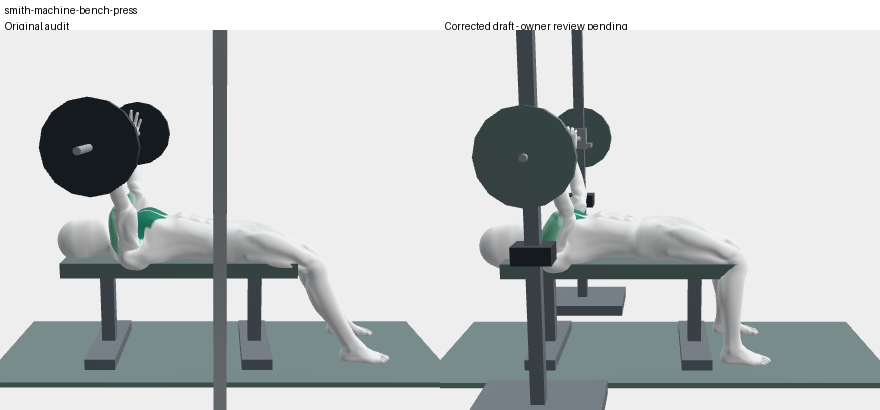
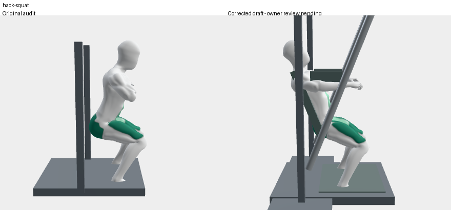
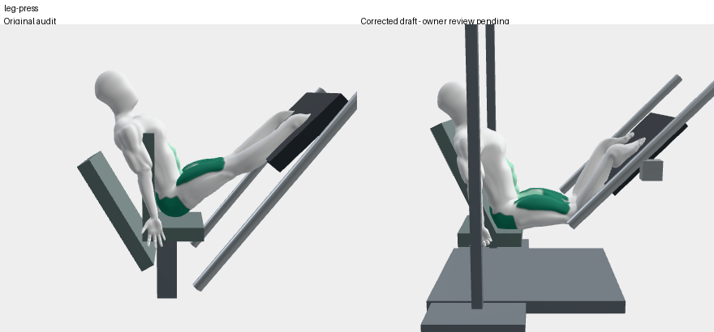
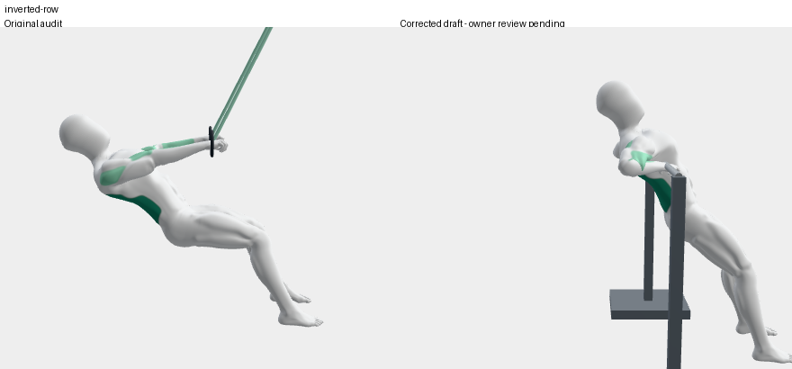
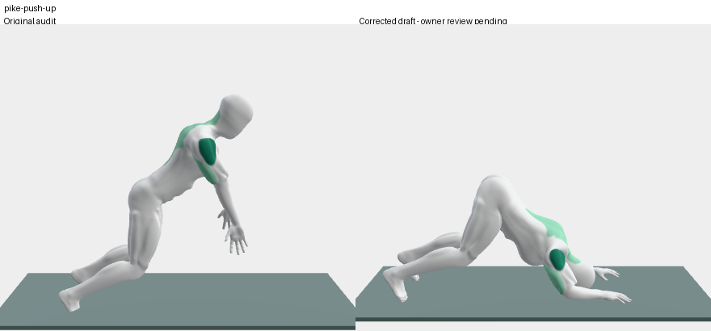
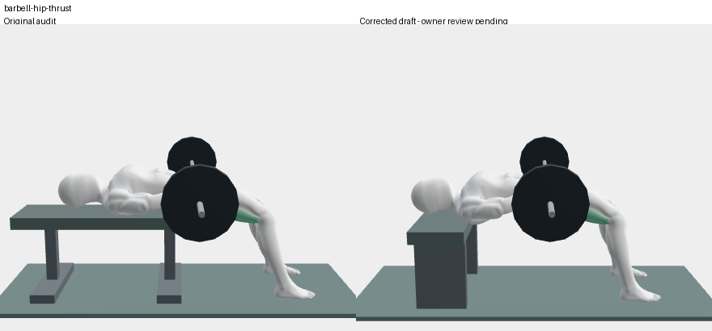
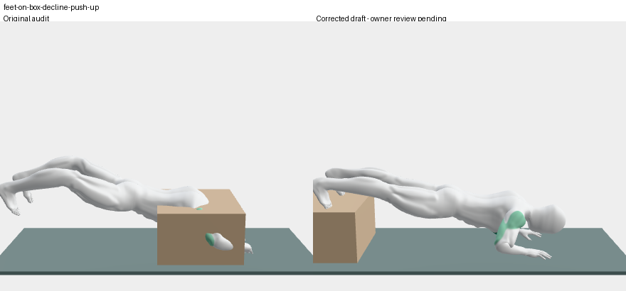
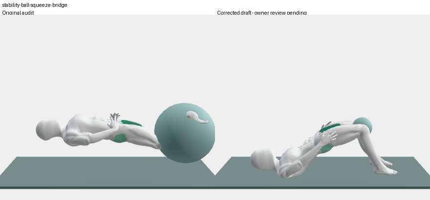
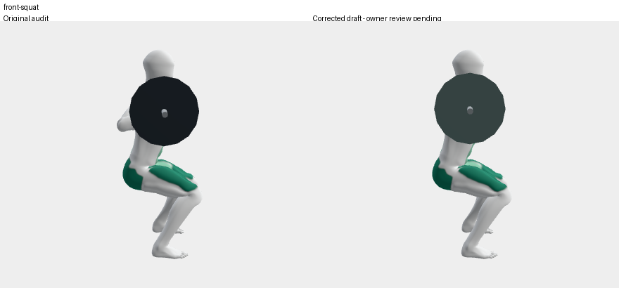
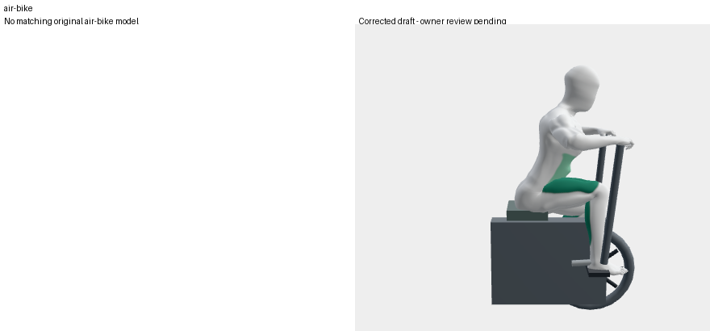

# Selected correction comparisons

November 13, 2026. Left: frozen original audit; right: corrected owner-review draft. These sampled views do not establish professional form approval. Air bike has only the new matching model because the previous app substituted a stationary bike.

