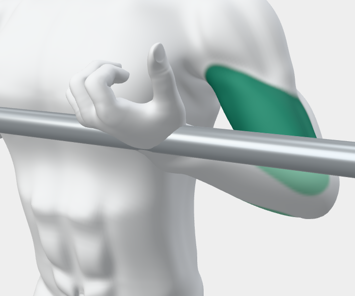
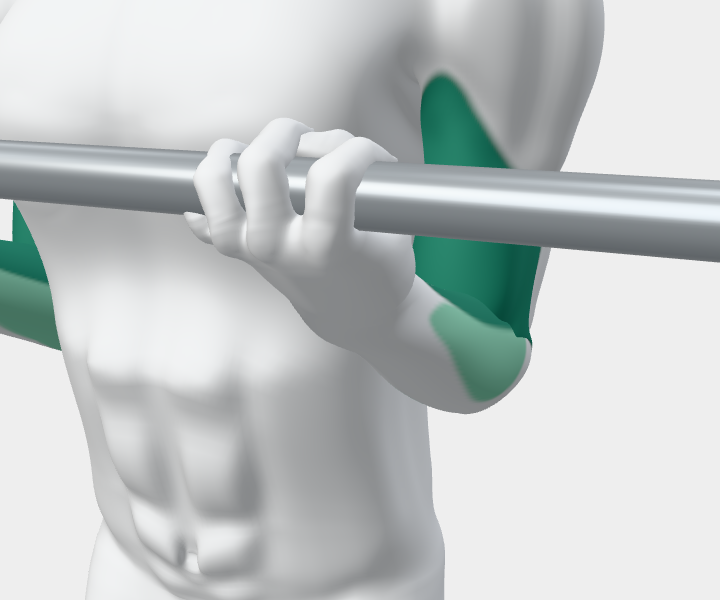
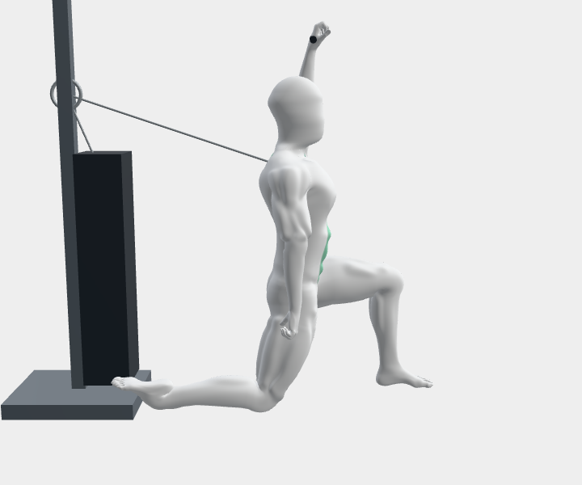
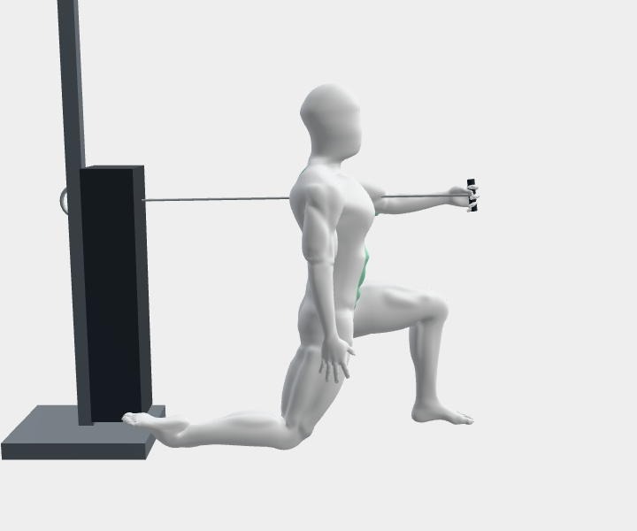
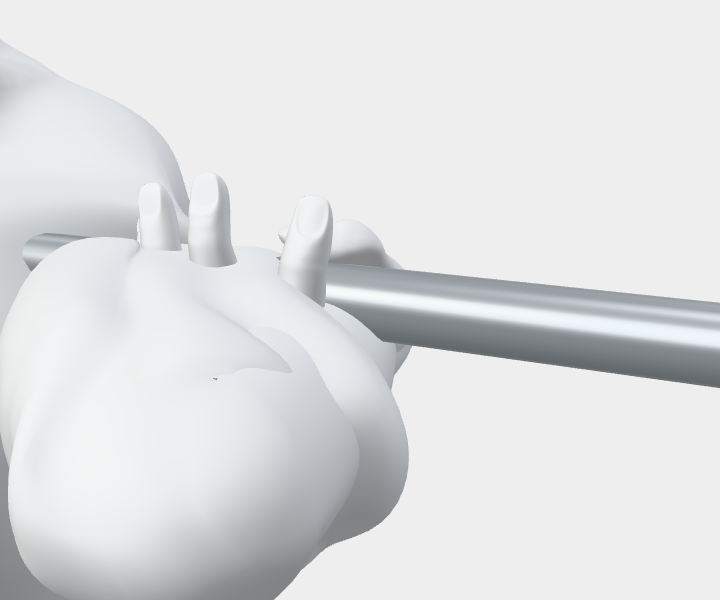
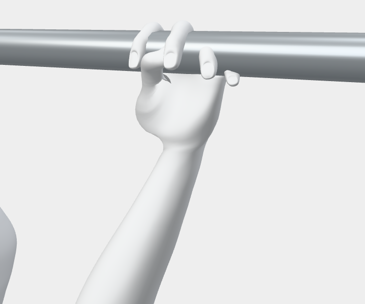

# Selected grip and movement evidence

Synthetic instructor renders, November 13, 2026. See the [dated review and limits](../../form-detail.md) and [candidate/source hashes](../../form-detail.json).

The earlier curl used a contact point near the wrist without closing the thumb. The revised grasp fits the finger bases and opposes the thumb.

The kneeling cable press now follows the detailed chest-height forward-press note.

Front-rack fingers hook under a body-supported bar; overhead grasps are checked against the actual rendered bar, rather than just an authored target.

These pictures document selected changes. They are not professional technique approval or proof of all fine skin/implement clearances.
